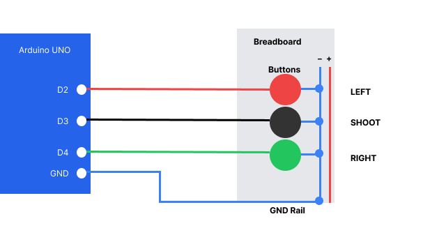
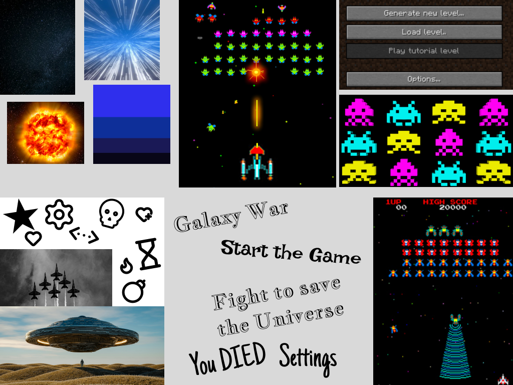

## Schematic View

<picture>
    
</picture>

## Arduino Controller

The Space Shooter game can be controlled using three physical push buttons connected to an Arduino UNO. The red button (D2) moves the spaceship left, the black button (D3) shoots bullets, and the green button (D4) moves the spaceship right.

The buttons use `INPUT_PULLUP`, meaning they return HIGH (1) when released and LOW (0) when pressed. The Arduino reads the button states every 20 milliseconds and sends them to the computer through USB using serial communication at 9600 baud.

The game uses the **Web Serial API** to receive these values in Google Chrome. JavaScript processes the incoming data and translates button presses into movement and shooting actions. The original keyboard controls remain available as an alternative. They are left arrow to go left right arrow to go right and space to shoot. 

## Moodboard

<picture>
    
</picture>

## Figma UI

[Figma UI ↗](https://www.figma.com/design/ipfHWDDEjTYDDyfGYmzjur/LucaFellmann-WebProject?node-id=14-199&t=oOxm1jKuoyxP8VCr-1)

## How to Run the Project

### 1. Start the Game

1. Download or clone the GitHub repository.
2. Open the `web-prototype` folder in Visual Studio Code.
3. Open `index.html` using the Live Server extension.
4. The game will open in Google Chrome.
5. Click **START THE BATTLE** to begin playing.

### 2. Connect the Arduino Controller

1. Connect the Arduino UNO to the computer using a USB cable.
2. Open `arduinoCode.ino` in the Arduino IDE and upload the code to the Arduino.
3. Close the Arduino IDE's Serial Monitor.
4. Start the game in Google Chrome.
5. Click **Connect Arduino** in the bottom-right corner.
6. Select the Arduino device in the browser popup to establish the connection.

### 3. Game Controls

| Action | Keyboard | Arduino Controller |
|---|---|---|
| Move left | Left arrow | Red button (D2) |
| Shoot | Spacebar | Black button (D3) |
| Move right | Right arrow | Green button (D4) |

### 4. Game Objective

The objective is to defend the universe by shooting incoming aliens before they reach the bottom of the screen.

- Yellow aliens give 1 point.
- Blue aliens give 2 points.
- Pink aliens give 3 points.

The player wins by reaching **100 points**. The game ends if an alien reaches the bottom of the screen.

### 5. Technical Requirements

- Google Chrome with Web Serial API support
- Arduino UNO connected via USB
- Three push buttons connected to digital pins D2, D3, and D4
- Serial communication at 9600 baud

The game can also be played using the keyboard without connecting an Arduino.